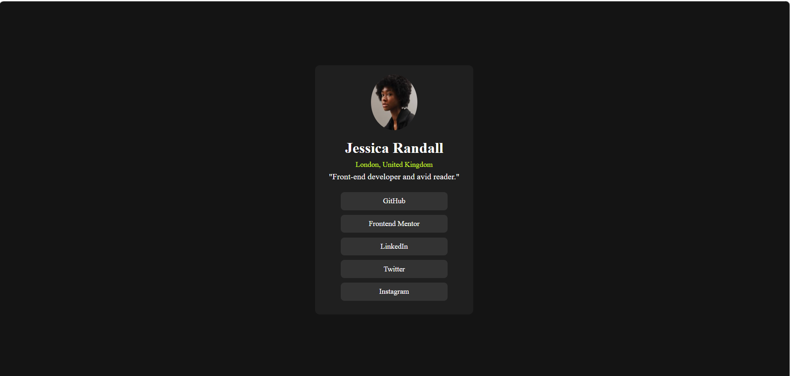

## Table of contents

## Overview:

This is my solution to the Social links profile challenge on Frontend Mentor. 
I built a profile card using HTML and CSS with Flexbox for layout and positioning.

### The challenge:

Users should be able to:

- See hover and focus states for all interactive elements on the page

### Screenshot:

### Links:

- Live Site URL: https://dappuvarshitha.github.io/social-links-profile/

### My process

- I started by structuring the HTML first, then moved on to styling with CSS.
- I used Flexbox to center the card on the page and stack the elements vertically.
- I referred to the style guide provided for colors and font sizes.

### Built with

- Semantic HTML5 markup
- CSS custom properties

### What I learned

- How to center a card vertically using flexbox by adding `height: 100vh` to the body
- How to stack elements vertically using `flex-direction: column`
- How to make circular images using `border-radius: 50%` and equal width and height
- How to use HSL color values from a style guide
- How to wrap plain text in HTML tags like `
` to style them individually
- How to add spacing between elements using `gap` and `margin-top`

### Continued development

- Responsive design for different screen sizes
- Hover and focus states for interactive elements
- Using `<a>` tags for social links instead of `
` tags
- Deploying the project to a live site using GitHub Pages or Netlify
